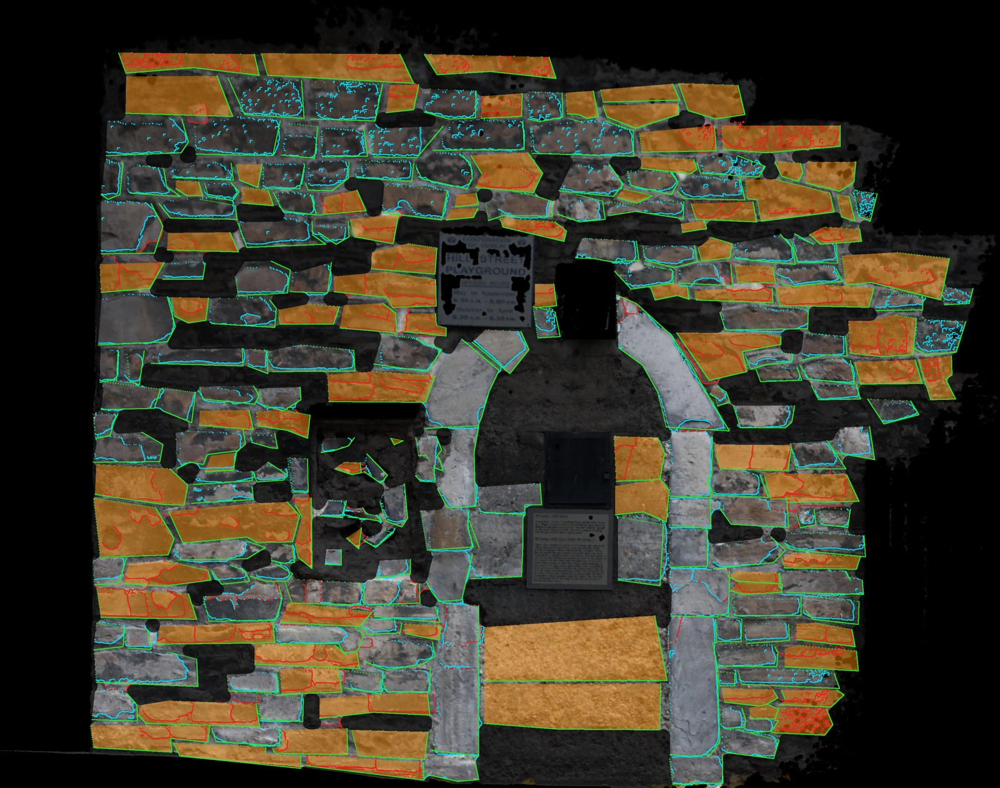

# Stone by Stone

**A per-stone digital twin of a masonry wall from handheld photographs.**

Photogrammetry and 3D Gaussian Splatting show what a wall looks like. This project
goes one step further and asks which stone is which: it reconstructs a real rubble
masonry wall, segments it into individual stones in 3D, measures each one, and puts
the result in a web viewer where every stone can be clicked.

> **Status: complete for `highwall`.** Results below are written by the pipeline
> (`python -m stonetwin report`); nothing here is typed by hand.



_Multi-view segmentation of `highwall` against the hand-drawn ground truth (green
outlines). Cyan: predicted stones matched at IoU ≥ 0.5. Red: unmatched predictions.
Orange: missed stones. Outside the evaluation region is dimmed._

**Live viewer:** _not deployed yet_ <!-- VIEWER_URL: replace with the GitHub Pages link after running the "Deploy viewer" workflow -->

## What it does

| Stage | Method | Output |
|---|---|---|
| Reconstruct | Structure-from-Motion, dense point cloud, 3D Gaussian Splatting | Camera poses, point cloud, splat |
| Frame | RANSAC wall-plane fit, gravity from the cameras' up direction | Wall coordinate frame (relative units) |
| Register | Two independent reconstructions from disjoint image subsets, aligned by a 7-DoF similarity transform (feature-based coarse step, then ICP) | Transform and residual |
| Parse | Foundation-model masks lifted to 3D by multi-view voting, compared with a 2.5D orthophoto baseline | A stone ID for every point |
| Describe | Per-stone geometry and colour statistics | `stones.json` |
| Verify | Hand-annotated ground truth, Hungarian matching | IoU, precision, recall |
| Show | Static three.js viewer | Click a stone, read its record |

## Results

<!-- RESULTS:START -->
| Result | Value |
|---|---|
| `highwall` splat, held-out PSNR / SSIM / LPIPS | 34.89 dB / 0.969 / 0.095 |
| `entrance` splat, held-out PSNR / SSIM / LPIPS | 22.75 dB / 0.819 / 0.232 |
| Stone segmentation F1 at IoU ≥ 0.5, multiview / ortho (231 hand-drawn stones) | 0.549 / 0.470 |
| Half-to-half registration: scale error vs. camera reference | 0.99 % |
| Open cavity stones set back (recession < 0) | 1.00 |

_Lengths are relative (scene units; the capture has no scale reference). Unitless results are unaffected._
<!-- RESULTS:END -->

Full tables and figures: [`docs/RESULTS.md`](docs/RESULTS.md).

## Scenes

| Scene | Subject | Images | Used for |
|---|---|---|---|
| `highwall` | St George's Hill Street church: rubble masonry wall with repairs and an open cavity | 42 | Full pipeline and evaluation |
| `entrance` | St. Audoen's Park: free-standing pointed stone arch (gate) | 155 | Reconstruction showcase |

Both were captured in Dublin with a Canon EOS R8 at 24 mm. See the
[dataset card](docs/DATA.md) for capture conditions and known problems.

## Per-stone record

<!-- RECORD:START -->
Stone 190 of 378 (`multiview` method), chosen by rule as the stone whose face area is closest to the median. Lengths in scene units (relative); frame: wall (x along wall, y up, z out of wall).

```json
{
  "id": 190,
  "n_points": 1650,
  "centroid_wall": [-5.301, 0.748, -0.01711],
  "face_area": 0.06389,
  "width": 0.232,
  "height": 0.34,
  "aspect_ratio": 0.6824,
  "roughness_rms": 0.002015,
  "colour_lab": [28.98, 2.254, 2.773],
  "colour_std": 6.585,
  "colour_delta_e": 7.398,
  "recession": -0.006657,
  "n_neighbours": 20,
  "outline_wall": "[169 vertices, omitted here]"
}
```
<!-- RECORD:END -->

The record is copied from `stones.json` by `python -m stonetwin report`.
`roughness_rms`, `recession` and `colour_delta_e` are condition proxies computed from
geometry and colour. They are not a classification of deterioration and have not been
validated against expert survey.

## Reproduce

```bash
conda env create -f environment.yml
conda activate stonetwin

# place photos in data/raw/<scene>/
python -m stonetwin all --scene highwall

cd viewer && npm install && npm run dev
```

Each stage can be run alone, for example `python -m stonetwin segment --scene highwall`.
Outputs land in `outputs/<scene>/`, one folder per stage, each with a `stage.json`
recording parameters, tool versions and metrics.

## Limitations

- **Image-only capture, relative scale.** No laser scanning, no surveyed control and no
  scale reference in the scene, so every length and area is in relative scene units.
  Counts, IoU, F1 and ratios are unaffected.
- **Independent reconstructions bend differently.** The residual between the two
  half-reconstructions contains a smooth bowl, which a similarity transform cannot
  absorb. A control run with the lens calibration held fixed shrinks both the bowl and
  the scale error to less than half (see RESULTS), so the bowl comes mainly from each
  half calibrating its own lens distortion, which a near-parallel capture constrains
  poorly. A weaker pattern remains. A fixed calibration, a laser scan or oblique and
  convergent frames would reduce it.
- **The registration experiment is an easy case.** It splits one capture session in
  two, so it tests the estimator, not change over time, and both halves came out in
  similar gauges, so the estimator was not stressed by a large rotation or scale change.
- **Segmentation over-splits and is class-agnostic.** The multi-view method splits
  two-tone stones, and the segmentation model (used as released, with no fine-tuning
  on masonry) labels any object as a stone. The two plaques and the metal door are
  removed by hand-drawn exclusion polygons; other non-stone objects, such as the dark
  gate at the right edge, are not.
- **Recession is relative to the neighbours.** With a neighbourhood larger than the
  cavity, cavity stones read as set back, but stones framing the opening read as proud.
  The proxy measures relief, not damage.
- **Runs are not bit-reproducible, and there is no fixed gauge.** GPU stereo varies
  slightly between runs and, because the scene has no absolute scale, each run has its
  own scale and origin, so stone counts change a little. The ground truth is
  re-registered to each run's orthophoto by image features, and the residual is
  reported.
- **One wall, one annotator.** The ground truth covers the whole `highwall` face but was
  drawn by one person, with no second annotation to measure agreement.
- **Not done:** the splat layer in the viewer, stone segmentation on `entrance`, and a
  second-epoch capture for a true change comparison.

## Repository layout

```
configs/        pipeline defaults and per-scene overrides
data/           ground-truth annotations (raw photos are not in git)
docs/           requirements, technical spec, dataset card, decisions, results
src/stonetwin/  pipeline stages
tests/          unit tests for geometry and metrics
viewer/         web viewer
```

## Documentation

- [Requirements](docs/PRD.md)
- [Technical specification](docs/TECH_SPEC.md)
- [Dataset card](docs/DATA.md)

## Related work

The orthophoto baseline follows the 2.5D idea used for rubble masonry by Valero,
Bosché and Forster (*Automation in Construction*, 2018). Segmenting stones in images
and transferring them to point clouds for stone-level analysis is explored by Tobies
et al. (*ISPRS Annals*, 2026).

## Licence

Code: [MIT](LICENSE). Photographs © Yuhui Cao.

## Author

Yuhui Cao, M.Sc. Computer Science, Trinity College Dublin.
