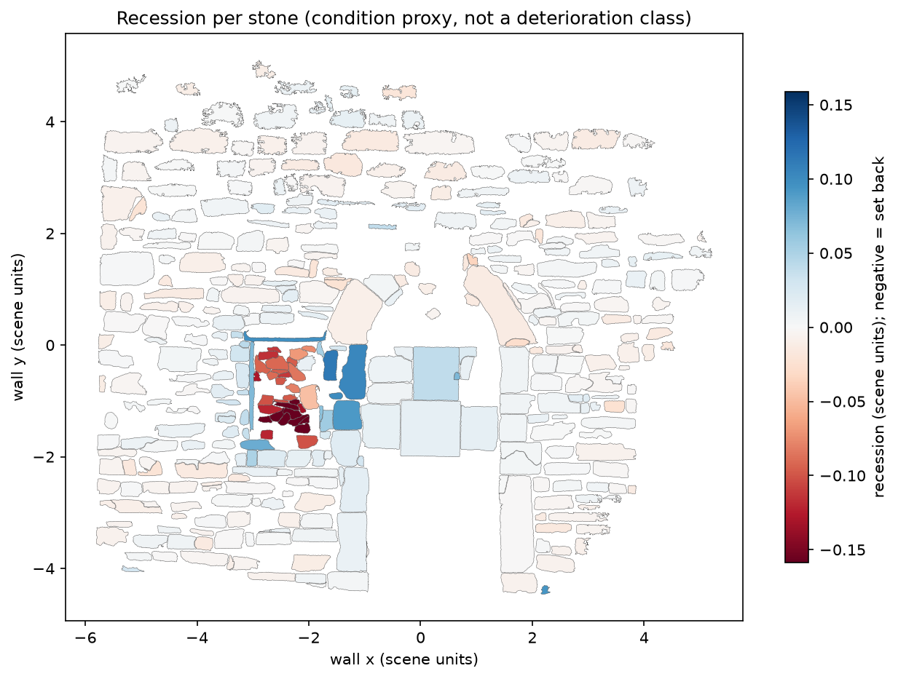

# Results

_Generated by `python -m stonetwin report` from `outputs/<scene>/metrics.json`. Do not edit by hand._

> **Not yet metric.** No scale references have been entered, so lengths and areas for `highwall` are in arbitrary scene units (the wall region is 12.5 units wide). Ratios, counts, IoU and F1 are unitless and unaffected.

## Reconstruction

| Scene | Images used | Registered | Mean reproj. error (px) | Sparse points | Splat PSNR (dB) | SSIM | LPIPS | Held-out views |
|---|---|---|---|---|---|---|---|---|
| `highwall` | 40 | 1.000 | 0.703 | 39,999 | 34.75 | 0.969 | 0.096 | 5 |
| `entrance` | 147 | 1.000 | 0.762 | 41,763 | 22.75 | 0.819 | 0.232 | 19 |

Splat metrics are on held-out views only (1 image in 8 is never trained on).

Dense cloud (`highwall`, colmap_mvs): 2,496,498 points; wall region 2,120,436 points; wall-plane inlier RMS 0.0056 scene units.

## Registration of two independent half-reconstructions (`highwall`)

One capture session split in two by capture order; each half reconstructed separately, then aligned by a similarity transform (FPFH + RANSAC, then point-to-plane ICP with joint scale). This tests the estimator, not change over time.

| Quantity | Value |
|---|---|
| Images per half (registered) | 20 / 20 |
| Estimated scale | 1.0325 |
| Rotation angle (deg) | 4.53 |
| ICP converged, iterations | yes, 7 |
| Fitness | 0.829 |
| Inlier RMSE (scene units of half A) | 0.0116 |
| Cloud-to-cloud, overlap: median / 95th pct | 0.0084 / 0.0204 |
| Point spacing of half A (median NN) | 0.0040 |
| vs. camera-pose reference: scale error | 0.90 % |
| vs. camera-pose reference: rotation error (deg) | 0.197 |
| vs. camera-pose reference: translation error / scene size | 0.191 % |

The signed residual on the wall is a smooth bowl, not noise: each half calibrated its own lens distortion, which bends each reconstruction slightly differently. A similarity transform cannot absorb it.

## Stone segmentation (`highwall`)

| | ortho (baseline) | multiview (main) |
|---|---|---|
| Stones found, whole wall | 273 | 396 |
| Fraction of points labelled | 0.337 | 0.521 |
| Ground-truth stones in region | 231 | 231 |
| Predictions in region | 208 | 296 |
| True positives | 102 | 138 |
| Precision | 0.490 | 0.466 |
| Recall | 0.442 | 0.597 |
| **F1** | 0.465 | 0.524 |
| Mean IoU of matched pairs | 0.742 | 0.746 |
| Over-segmented GT stones | 28 | 49 |
| Under-segmenting predictions | 1 | 2 |
| F1 at IoU ≥ 0.3 (for information) | 0.601 | 0.698 |
| F1 at IoU ≥ 0.7 (for information) | 0.287 | 0.361 |

Matching: Hungarian on IoU, true positive at IoU ≥ 0.5. Ground truth: 231 stones drawn by hand on the orthophoto; evaluation region derived (closing 41 px).

Green: ground truth. Cyan: matched predictions. Red: unmatched predictions. Orange: missed ground-truth stones.

## Per-stone attributes (`highwall`, multiview)

`roughness_rms`, `recession` and `colour_delta_e` are **condition proxies**: geometric and colour measurements, not validated deterioration classes.

| Quantity | Value |
|---|---|
| Stones with records | 396 |
| Median face area (scene units²) | 0.0619 |
| Median roughness RMS (scene units) | 0.0040 |
| Median colour ΔE00 to wall median | 7.17 |
| Open cavity: stones / median recession (scene units) | 26 / -0.1074 |
| Open cavity: fraction of stones set back | 0.96 |
| Rest of wall: median / 5th pct recession (scene units) | 0.0011 / -0.0164 |

