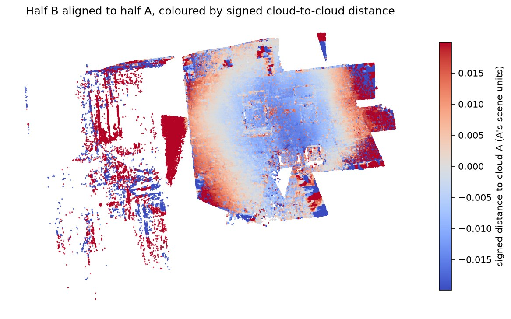

# Results

_Generated by `python -m stonetwin report` from `outputs/<scene>/metrics.json`. Do not edit by hand._

> **Not yet metric.** No scale references have been entered, so lengths and areas for `highwall` are in arbitrary scene units (the wall region is 12.6 units wide). Ratios, counts, IoU and F1 are unitless and unaffected.

## Reconstruction

| Scene | Images used | Registered | Mean reproj. error (px) | Sparse points | Splat PSNR (dB) | SSIM | LPIPS | Held-out views |
|---|---|---|---|---|---|---|---|---|
| `highwall` | 40 | 1.000 | 0.692 | 44,304 | 34.89 | 0.969 | 0.095 | 5 |
| `entrance` | 147 | 1.000 | 0.762 | 41,763 | 22.75 | 0.819 | 0.232 | 19 |

Splat metrics are on held-out views only (1 image in 8 is never trained on).

Dense cloud (`highwall`, colmap_mvs): 2,468,273 points; wall region 2,091,844 points; wall-plane inlier RMS 0.0055 scene units.

## Registration of two independent half-reconstructions (`highwall`)

One capture session split in two by capture order; each half reconstructed separately, then aligned by a similarity transform (FPFH + RANSAC, then point-to-plane ICP with joint scale). This tests the estimator, not change over time.

| Quantity | Value |
|---|---|
| Images per half (registered) | 20 / 20 |
| Estimated scale | 1.0355 |
| Rotation angle (deg) | 6.87 |
| ICP converged, iterations | yes, 6 |
| Fitness | 0.826 |
| Inlier RMSE (scene units of half A) | 0.0121 |
| Cloud-to-cloud, overlap: median / 95th pct | 0.0090 / 0.0219 |
| Point spacing of half A (median NN) | 0.0040 |
| vs. camera-pose reference: scale error | 0.99 % |
| vs. camera-pose reference: rotation error (deg) | 0.196 |
| vs. camera-pose reference: translation error / scene size | 0.215 % |

The signed residual on the wall is a smooth bowl, not noise: each half calibrated its own lens distortion, which bends each reconstruction slightly differently. A similarity transform cannot absorb it.

## Stone segmentation (`highwall`)

| | ortho (baseline) | multiview (main) |
|---|---|---|
| Stones found, whole wall | 284 | 383 |
| Fraction of points labelled | 0.356 | 0.529 |
| Ground-truth stones in region | 231 | 231 |
| Predictions in region | 216 | 286 |
| True positives | 105 | 142 |
| Precision | 0.486 | 0.497 |
| Recall | 0.455 | 0.615 |
| **F1** | 0.470 | 0.549 |
| Mean IoU of matched pairs | 0.736 | 0.741 |
| Over-segmented GT stones | 34 | 46 |
| Under-segmenting predictions | 1 | 2 |
| F1 at IoU ≥ 0.3 (for information) | 0.595 | 0.700 |
| F1 at IoU ≥ 0.7 (for information) | 0.273 | 0.364 |

Matching: Hungarian on IoU, true positive at IoU ≥ 0.5. Ground truth: 231 stones drawn by hand on the orthophoto; evaluation region derived (closing 41 px).

The annotation was drawn on the orthophoto of an earlier run; it is registered to this run's orthophoto by SIFT + RANSAC similarity (6,545 inlier matches, residual 1.17 px RMS, scale 1.0020).

Green: ground truth. Cyan: matched predictions. Red: unmatched predictions. Orange: missed ground-truth stones.

## Per-stone attributes (`highwall`, multiview)

`roughness_rms`, `recession` and `colour_delta_e` are **condition proxies**: geometric and colour measurements, not validated deterioration classes.

| Quantity | Value |
|---|---|
| Stones with records | 383 |
| Median face area (scene units²) | 0.0665 |
| Median roughness RMS (scene units) | 0.0041 |
| Median colour ΔE00 to wall median | 7.40 |
| Open cavity: stones / median recession (scene units) | 24 / -0.1103 |
| Open cavity: fraction of stones set back | 1.00 |
| Rest of wall: median / 5th pct recession (scene units) | 0.0010 / -0.0180 |

