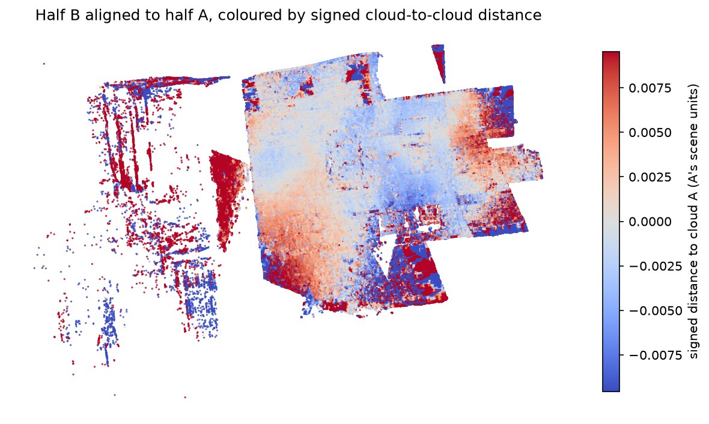
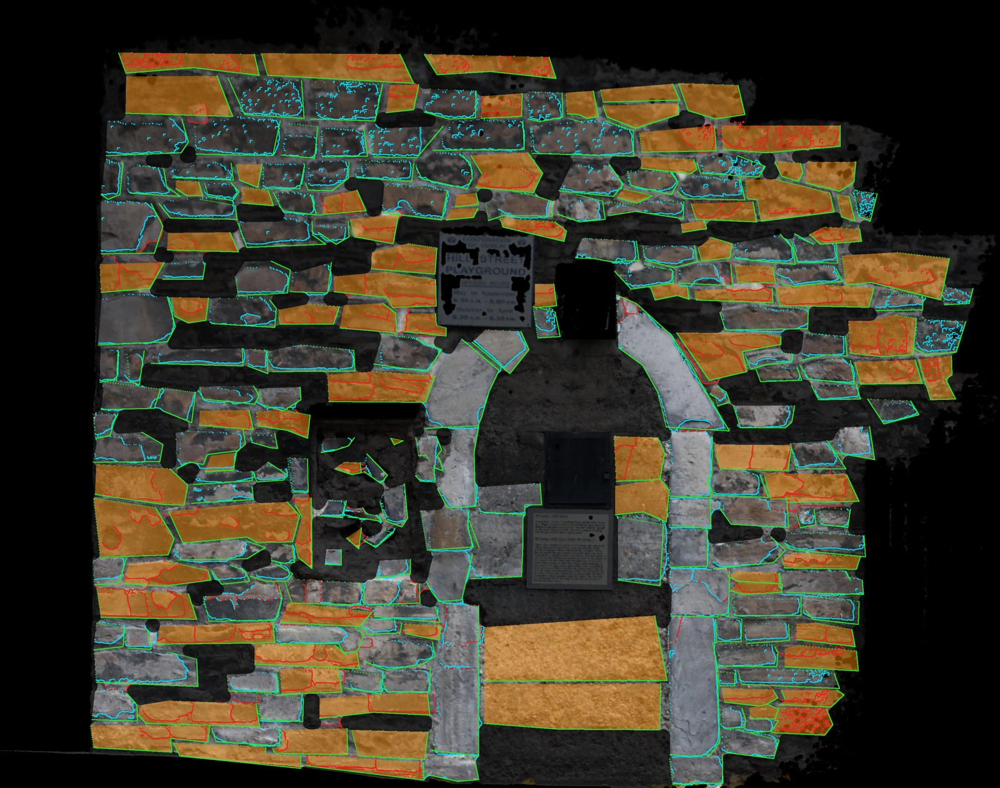

# Results

_Generated by `python -m stonetwin report` from `outputs/<scene>/metrics.json`. Do not edit by hand._

> **Relative units.** The capture contains no scale reference, so lengths and areas for `highwall` are in relative scene units (the wall region is 12.6 units wide). Ratios, counts, IoU and F1 are unitless and unaffected.

## Reconstruction

| Scene | Images used | Registered | Mean reproj. error (px) | Sparse points | Splat PSNR (dB) | SSIM | LPIPS | Held-out views |
|---|---|---|---|---|---|---|---|---|
| `highwall` | 40 | 1.000 | 0.692 | 44,304 | 34.89 | 0.969 | 0.095 | 5 |
| `entrance` | 147 | 1.000 | 0.762 | 41,763 | 22.75 | 0.819 | 0.232 | 19 |

Splat metrics are on held-out views only (1 image in 8 is never trained on).

Dense cloud (`highwall`, colmap_mvs): 2,468,273 points; wall region 2,091,844 points; wall-plane inlier RMS 0.0055 scene units.

## Registration of two independent half-reconstructions (`highwall`)

One capture session split in two by capture order; each half reconstructed separately, then aligned by a similarity transform (FPFH + RANSAC, then point-to-plane ICP with joint scale). This tests the estimator, not change over time.

| Quantity | Value |
|---|---|
| Images per half (registered) | 20 / 20 |
| Estimated scale | 1.0355 |
| Rotation angle (deg) | 6.87 |
| ICP converged, iterations | yes, 6 |
| Fitness | 0.826 |
| Inlier RMSE (scene units of half A) | 0.0121 |
| Cloud-to-cloud, overlap: median / 95th pct | 0.0090 / 0.0219 |
| Point spacing of half A (median NN) | 0.0040 |
| vs. camera-pose reference: scale error | 0.99 % |
| vs. camera-pose reference: rotation error (deg) | 0.196 |
| vs. camera-pose reference: translation error / scene size | 0.215 % |

### Control: intrinsics held fixed

The same two halves were reconstructed again with focal length, principal point and distortion fixed to the full-scene model's values (no refinement in bundle adjustment), then aligned and measured the same way. Bowl amplitude: a quadric is fitted to the signed residual over the overlap, in the wall plane; the value is the spread (99th − 1st percentile) of its quadratic part. Lengths are divided by the diagonal of half A so the two runs, each in its own gauge, compare.

| | each half calibrates itself | intrinsics fixed |
|---|---|---|
| Bowl amplitude (quadratic part, p99 − p1) / scene size | 0.180 % | 0.041 % |
| Share of residual variance explained by a quadric | 0.36 | 0.11 |
| Signed residual RMS / scene size | 0.079 % | 0.034 % |
| Cloud-to-cloud median, overlap / scene size | 0.068 % | 0.031 % |
| Scale error vs. camera reference | 0.99 % | 0.22 % |
| Rotation error vs. camera reference (deg) | 0.196 | 0.141 |
| Translation error / scene size | 0.215 % | 0.031 % |

Residual with the intrinsics fixed. Each residual figure clips its colour scale at its own 95th percentile of the absolute residual, so compare the colour bars, not only the colours.

With the intrinsics fixed, the bowl and the scale error both shrink to less than half. The bowl in the baseline therefore comes mainly from each half calibrating its own lens distortion, which a near-parallel capture constrains poorly; a similarity transform cannot absorb it. A weaker large-scale pattern remains with the intrinsics fixed, so it is not the only source. Caveat: the fixed intrinsics and the camera-pose reference both come from the full-scene model, so the reference errors in the control are not fully independent of it; the bowl amplitude is measured cloud to cloud and does not use the reference.

## Stone segmentation (`highwall`)

| | ortho (baseline) | multiview (main) |
|---|---|---|
| Stones found, whole wall | 278 | 378 |
| Fraction of points labelled | 0.334 | 0.495 |
| Stones removed by the 3 exclusion polygons (plaques, metal door; D-021) | 6 | 5 |
| Ground-truth stones in region | 231 | 231 |
| Predictions in region | 216 | 286 |
| True positives | 105 | 142 |
| Precision | 0.486 | 0.497 |
| Recall | 0.455 | 0.615 |
| **F1** | 0.470 | 0.549 |
| Mean IoU of matched pairs | 0.736 | 0.741 |
| Over-segmented GT stones | 34 | 46 |
| Under-segmenting predictions | 1 | 2 |
| F1 at IoU ≥ 0.3 (for information) | 0.595 | 0.700 |
| F1 at IoU ≥ 0.7 (for information) | 0.273 | 0.364 |

Matching: Hungarian on IoU, true positive at IoU ≥ 0.5. Ground truth: 231 stones drawn by hand on the orthophoto; evaluation region derived (closing 41 px).

The annotation was drawn on the orthophoto of an earlier run; it is registered to this run's orthophoto by SIFT + RANSAC similarity (6,545 inlier matches, residual 1.17 px RMS, scale 1.0020).

Green: ground truth. Cyan: matched predictions. Red: unmatched predictions. Orange: missed ground-truth stones.

## Per-stone attributes (`highwall`, multiview)

`roughness_rms`, `recession` and `colour_delta_e` are **condition proxies**: geometric and colour measurements, not validated deterioration classes.

| Quantity | Value |
|---|---|
| Stones with records | 378 |
| Median face area (scene units²) | 0.0640 |
| Median roughness RMS (scene units) | 0.0041 |
| Median colour ΔE00 to wall median | 7.31 |
| Open cavity: stones / median recession (scene units) | 24 / -0.1103 |
| Open cavity: fraction of stones set back | 1.00 |
| Rest of wall: median / 5th pct recession (scene units) | 0.0008 / -0.0179 |

